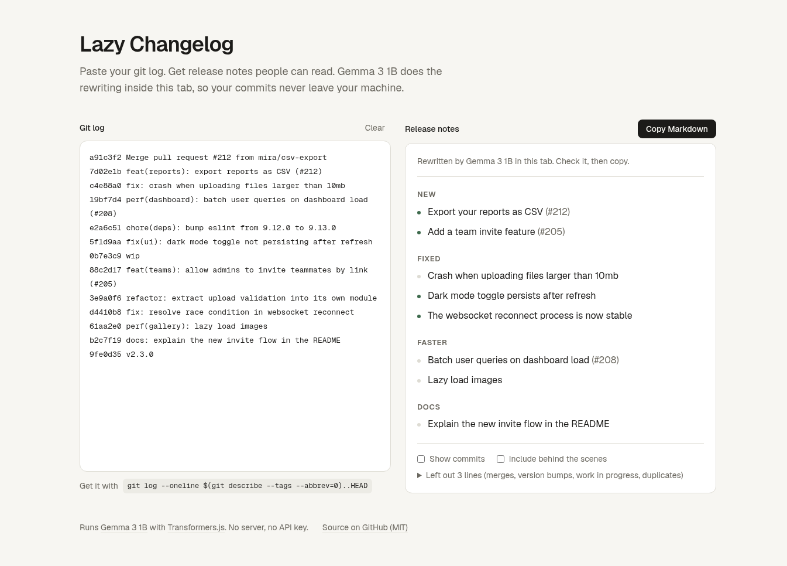

# Lazy Changelog

Paste your git log. Get release notes people can read. Nothing leaves your browser.

**Live:** https://lazy-changelog.vercel.app



## Why

Writing release notes is the chore everyone skips. The information is already in your commits; it is just written for you, not for your users. Lazy Changelog does the boring part for you:

1. Run one command in your repo:

   ```sh
   git log --oneline $(git describe --tags --abbrev=0)..HEAD
   ```

2. Paste the output.
3. Copy the Markdown.

## How it works

**Instant draft, no model needed.** A small parser (`src/lib/parse.ts`) reads the log the moment you paste it. It groups commits into New, Fixed, Faster, Docs and Behind the scenes, strips conventional commit prefixes, gitmoji, `[tags]` and hashes, keeps PR numbers, puts breaking changes first, and drops noise like merges, version bumps, `wip` and `fixup!` commits and duplicates. This draft is labeled as a draft.

**Then Gemma rewrites the lines users care about.** Click "Load Gemma 3 1B" once. The app downloads [onnx-community/gemma-3-1b-it-ONNX](https://huggingface.co/onnx-community/gemma-3-1b-it-ONNX) and runs it in a Web Worker with [Transformers.js](https://github.com/huggingface/transformers.js). Each New, Fixed and Faster line is rewritten one at a time, in plain words, with a short per-kind prompt and a few examples (`src/lib/prompt.ts`). Output that does not look like a release note line (an echo, an empty reply, a ramble) is thrown away and the original line is kept, marked "kept as written". Nothing is invented to fill gaps.

**After the first load it is fully lazy.** The browser caches the weights. On your next visit the model loads on its own and rewrites whatever you paste.

| Your browser     | Backend      | Weights | Download                 |
| ---------------- | ------------ | ------- | ------------------------ |
| WebGPU available | `webgpu`     | `q4f16` | about 760 MB, once       |
| No WebGPU        | `wasm` (CPU) | `uint8` | about 1 GB, once, slower |

If the model cannot load, the draft stays on screen and still copies.

## Privacy

There is no backend and no API key. Your commits are parsed and rewritten in your tab. The only network requests are the app itself and the model files from Hugging Face.

## Run it locally

```sh
npm install
npm run dev        # http://localhost:3000
npm test           # parser and prompt tests (Vitest)
npm run lint
npm run typecheck
npm run build
```

Built with Next.js, React, TypeScript, Tailwind CSS and Transformers.js.

## Notes

Built from scratch on October 24, 2026 for the DEV Hacktoberfest Open-Source AI Challenge, Week 3: Slow and Steady. Written with help from an AI coding assistant; every feature was tested by hand on the live site.

## License

[MIT](LICENSE)
